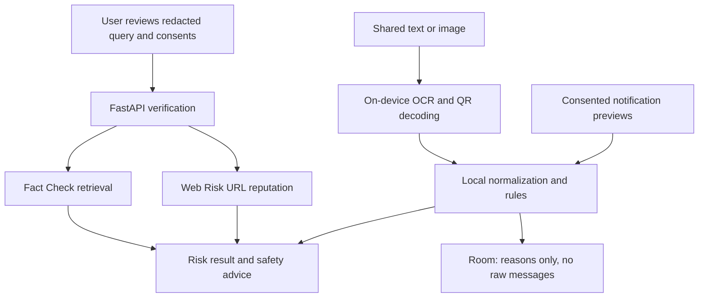

# PS2 architecture

Source of scope: GOD_VALLEY_PS2.md. Native Android only.

## Boundaries
No chat history, SMS database permissions, accessibility scraping, screen capture, transaction interception or VPN. Notification contents remain local. Cloud checks require a separate preview and approval for each query. URLs lose query/fragment/userinfo before verification. Never visit submitted URLs in the API process. Redirect inspection needs an isolated egress-restricted worker and remains disabled. Source text and API content are untrusted.

## Compact implementation
- MainActivity.kt: Compose onboarding, app selection, pause, sharing, query consent, result display.
- Detection.kt: local rules, QR intent, redaction and bounded parsing.
- Protection.kt: notification listener, Room reason history, WorkManager retention.
- backend/main.py: authenticated, bounded external verification, no request persistence.

## Model release gate
Rules are a baseline, not a pretrained model. No arbitrary unvalidated weights are bundled. Benchmark XLM-R or a lighter multilingual classifier against the baseline on independent Tamil, Tanglish and English campaign/time splits. Export selected model plus its exact tokenizer to ONNX. Require tested input/output schema, model license, calibrated thresholds and device latency/memory evidence before enabling inference. An absent model must remain visible in the UI.

## Remaining integrations
Gemini Flash must only explain retrieved evidence, never create verdicts. PostgreSQL is reserved for curated threat intelligence, not raw notifications. RDAP is a weak domain signal, not fraud proof. Threat update signatures, isolated redirects, validated ONNX inference and grounded Gemini are release gates, not implemented claims.

## Evaluation
Targets only: recall >=95%, false positive rate <=2%, local inference <500ms, online p95 <10s, unauthorized raw uploads zero. Measure notification coverage, battery and language-specific quality separately. No achieved metrics claimed.
