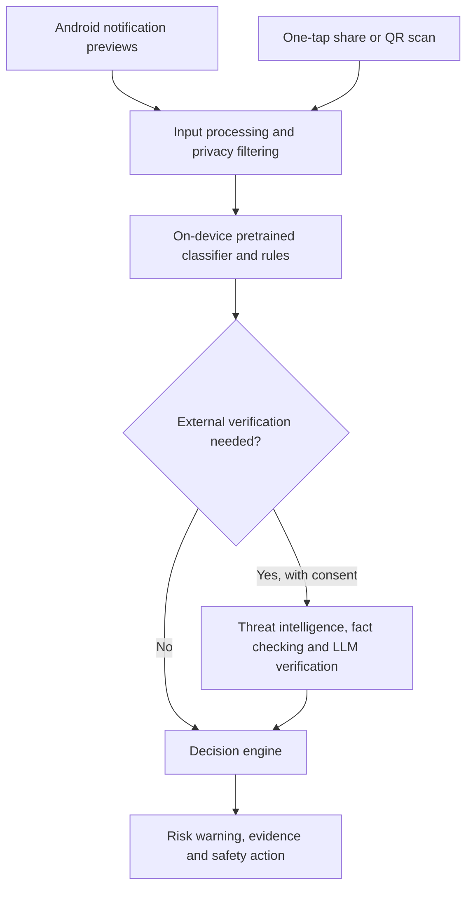

# PS2 — Scam and Misinformation Checker

## Slide 1 — Project Introduction

**Team: GOD VALLEY**

**Team Members:**
- G Ranjith Kumar
- F.Nazeer Hussain
- V.Naveen

**Project:** Android-native, proactive digital fraud and misinformation protection.

**Vision:** Detect suspicious content before users act on it, with minimal manual interaction.

---

## Slide 2 — Problem Statement & Differentiation

- Indian users encounter UPI fraud, fake KYC alerts, parcel scams, digital arrest impersonation and misleading viral forwards.
- Manual verification is inconvenient, especially for non-technical users.
- Existing messaging apps already detect spam and many scams; our focus is specialized financial fraud and factual claim verification.
- Dedicated English, Tamil and Tanglish analysis.
- Evidence-backed warnings and actionable safety recommendations.

---

## Slide 3 — Proposed Solution & User Workflow

1. Install the Android app and explicitly enable notification access.
2. Automatically analyse available SMS, WhatsApp and Telegram notification previews locally.
3. Identify suspicious language, URLs and payment requests using pretrained ML and deterministic rules.
4. Perform selective online verification with consent when additional evidence is needed.
5. Display a risk warning, supporting evidence and recommended action.

**Fallback:** One-tap Android sharing for screenshots, QR codes and content unavailable in notifications. No routine manual uploading required.

---

## Slide 4 — System Architecture

**Technology stack:** Kotlin, Jetpack Compose, NotificationListenerService, ONNX Runtime, Room, WorkManager, ML Kit QR scanning, FastAPI, PostgreSQL, Web Risk, RDAP and Gemini Flash.

**Model strategy:** Evaluate existing multilingual scam classifiers and datasets before selecting and fine-tuning a lightweight model. Benchmark on independent real-world Indian messages.

---

## Slide 5 — Core Features & Innovation

| Feature | Implementation |
|---|---|
| Automatic scam screening | On-device pretrained ML and heuristic rules |
| Phishing verification | URL reputation, domain inspection and safe redirect analysis |
| UPI fraud detection | Identify payment intent and misleading refund claims from shared QR codes |
| Misinformation checking | Extract claims and retrieve authoritative sources |
| Regional language support | English, Tamil and Tanglish normalization and classification |
| Evidence-backed decisions | Combine independent signals; escalate ambiguous cases selectively |

**Scam verdicts:** Low Risk, Suspicious, High Risk, Unverified.

**Example:** A fake KYC notification triggers an alert explaining the suspicious link and urgency, advising the user to verify through the official banking app.

---

## Slide 6 — Feasibility, Privacy & Trust

- Android notification access is supported with explicit user permission, but only exposed notification content is available.
- No private chat history access, root access, automatic screen recording or banking transaction interception.
- Screenshots and QR images require user sharing or scanning when not accessible in notifications.
- Local processing by default; minimize and redact sensitive data before authorized external verification.
- Isolate suspicious URL inspection and treat submitted content as untrusted data.
- Google Play distribution, transparent Data Safety disclosure and independent security testing.
- Never guarantee a message is genuine or a payment recipient is trustworthy solely from a model or QR payload.

---

## Slide 7 — Implementation Roadmap & Expected Impact

**Development phases**
1. Prove notification access across Android devices.
2. Benchmark and integrate existing pretrained classifiers.
3. Add URL intelligence and financial scam rules.
4. Integrate fact checking, QR analysis and multilingual explanations.
5. Conduct security, battery, latency and detection testing.

**Proposed validation targets (not measured results):**
- Scam detection recall: ≥95%.
- False-positive rate: ≤2%.
- Local text inference: under 500 ms.
- Online scam verification P95: under 10 seconds.
- Unauthorized raw notification uploads: zero.

Evaluate notification coverage, Tamil/Tanglish accuracy and incremental detection value against existing protections separately.

**Expected impact:** Earlier fraud warnings, accessible regional-language guidance, reduced manual verification effort and informed digital decisions.

**GOD VALLEY — Protect before you act.**
